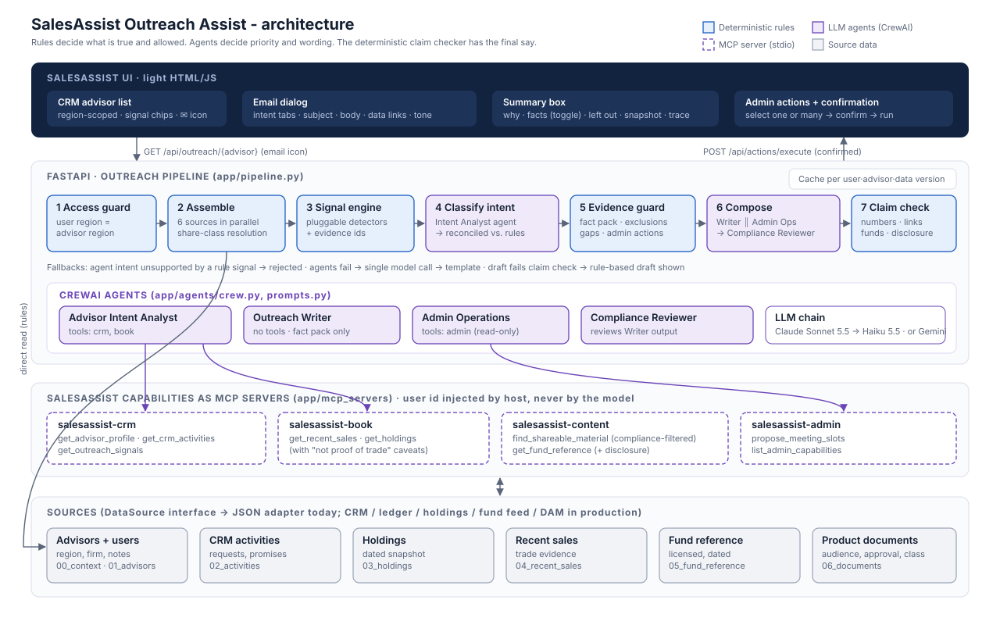
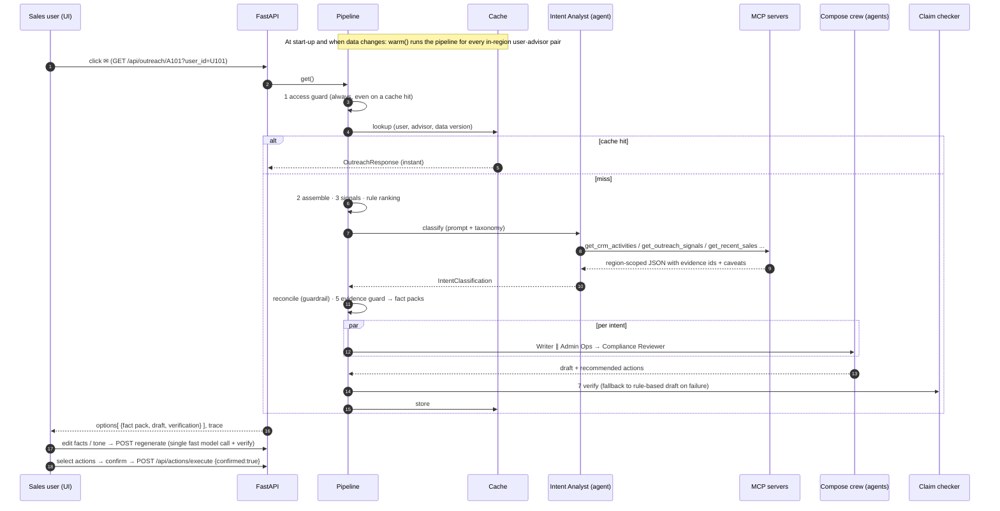

# Architecture

## The idea in one paragraph

Clicking the email icon runs a seven-step pipeline:

1. Access check
2. Assemble the advisor's data
3. Detect signals
4. Classify intent
5. Build the fact pack
6. Compose the draft
7. Check every claim

Steps 1, 2, 3, 5 and 7 are **deterministic rules**. They decide what is true and what is allowed. Steps 4 and 6 are
**LLM agents** (CrewAI) that decide what matters most and how to say it. The agents reach SalesAssist data only
through **MCP servers** that enforce region scope and compliance filtering themselves. Every agent output passes
through a deterministic guardrail before the user sees it. Results are **pre-computed and cached**, so the dialog
opens instantly, as the brief requires.

## Components and responsibilities

| # | Component | File | Responsibility | Rules / agent |
|---|---|---|---|---|
| 1 | Access guard | `services/entitlement.py` | Blocks advisors outside the user's region before any data or model call. Re-checked on cache hits and on action execution | Rules |
| 2 | Context assembler | `services/context.py` | Fetches the 6 sources in parallel by `ADVISOR_ID`. Resolves CRM product names to share classes (exact, single class, "Class I" in the text, earlier activity in the same thread, or unresolved) | Rules |
| 3 | Signal engine | `services/signals.py` | Pluggable detectors: open request or promise, firm move (with reconnect timeframe), significant trade, upcoming birthday, new approved material. Each signal carries evidence IDs and caveats | Rules |
| 4a | Intent Analyst | `agents/crew.py`, `prompts.py` | Classifies and ranks intents from a fixed taxonomy, using MCP tools and evidence rules R1–R8 | Agent |
| 4b | Ranker and reconciler | `services/ranker.py`, `pipeline.reconcile` | Rule baseline with explainable scores. An agent intent is accepted only if a rule-detected signal of the same type, with overlapping evidence, backs it. Rule intents the agent missed are added back | Rules |
| 5 | Evidence guard | `services/evidence.py` | Builds the fact pack: allowed facts with source IDs, optional facts (fund data off by default), exclusions with reasons, gaps, banned terms, tone and suggested admin actions | Rules |
| 6 | Compose crew | `agents/crew.py` | The **Writer** (no tools, fact pack only) and **Admin Ops** (admin MCP) run in parallel, then the **Compliance Reviewer** reviews the Writer's output | Agents |
| 7 | Claim checker | `services/verifier.py` | Every URL, amount, percentage and fund name must come from an included fact. Excluded terms are absent. A disclosure is present whenever performance is quoted. A model draft that fails is replaced by the rule-based draft | Rules |
| – | Admin actions | `services/actions.py` | Suggests `log_activity`, `schedule_meeting`, `request_material`, `set_reminder` and `verify_contact`. The mock executor runs them only when `confirmed=true` | Rules |
| – | MCP servers | `mcp_servers/*.py` | `crm`, `book`, `content` and `admin` stand in for existing SalesAssist capabilities. The user ID comes from the server process environment, never from a tool argument | – |
| – | LLM layer | `services/llm.py`, `model_chain.py` | Claude by default (Sonnet 5.5, then Haiku 5.5), Gemini optional. Model chain with timeouts and retries. Adapter that runs CrewAI on the current Anthropic SDK (`ant auth login` works) | – |
| – | UI | `static/` | CRM list, email dialog, summary box, admin actions with confirmation. Vanilla JS with no build step | – |

## Data flows

## How it grows

* **New need, such as a market event affecting a holding:** add a detector in `signals.py`, an entry in
  `INTENT_FOR_SIGNAL`, a branch in `evidence.py` for its facts, and a key in `INTENT_TAXONOMY`.
  `meeting_follow_up` and `service_check_in` are already in the taxonomy. The guardrail rejects them today
  because v1 has no detector for them.
* **New data source:** implement it behind `DataSource` and expose it through an MCP server. Agents discover
  new tools automatically, and rules use the adapter directly.
* **New action:** add the type in `models.AdminAction`, a suggestion rule and an executor branch. In production,
  each executor calls the matching SalesAssist admin agent.
* **Production hosting:** run FastAPI on Azure Container Apps or App Service, use Azure Cache for Redis for the draft cache,
  Service Bus for "data changed, so re-warm" events, Entra ID for user identity and region claims, and MCP servers as sidecars
  or HTTP (streamable) services. Models are Claude via Microsoft Foundry or the Claude API (Gemini optional).
